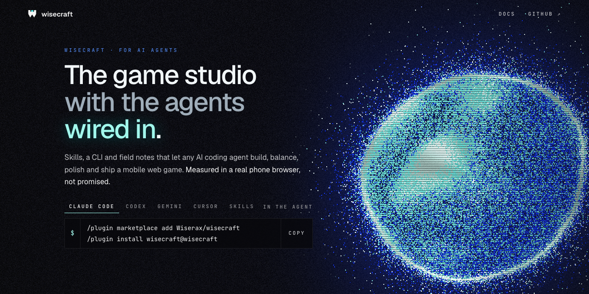
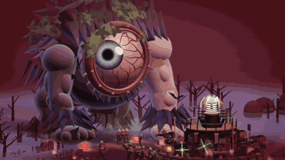
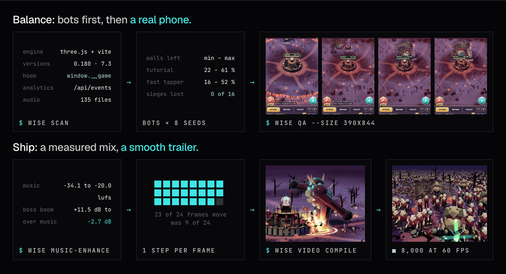
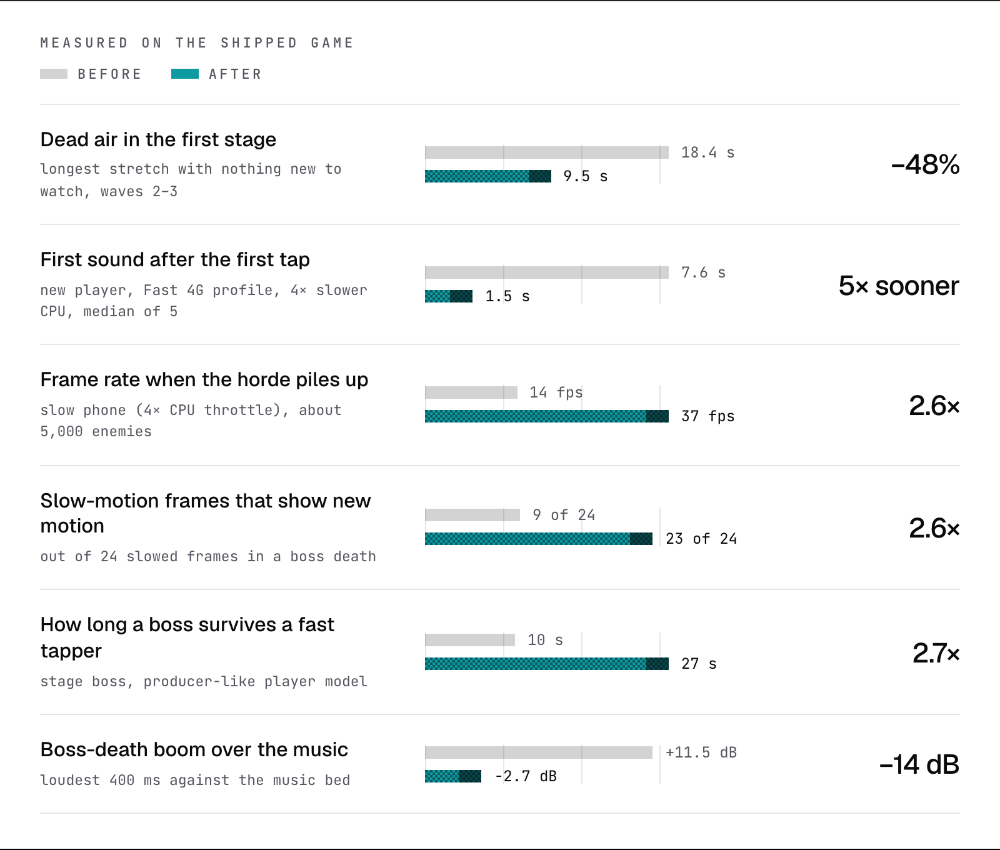

<p align="center">
  
</p>

<p align="center">
  <b>Skills, tools and a shared knowledge base that let any AI coding agent build, balance, polish and ship a mobile web game.</b><br>
  The agent scans the game, builds one playable slice, tunes the economy with simulated players, cleans up the UI, measures the sound
  instead of guessing, proves it in a muted phone browser, ships it, cuts the trailer, and writes down what it learned for the next agent.
</p>

<p align="center">
  <a href="#install"></a>
  <a href="knowledge/INDEX.md"></a>
  <a href="LICENSE"></a>
</p>

<p align="center">
  
</p>

<p align="center"><b>Website:</b> <a href="https://wiserax.dev/wisecraft/">wiserax.dev/wisecraft</a></p>

<p align="center"><b>Coming next: harder real-game benchmarks and more field notes.</b></p>

## Install

Pick your agent. Each gets the same skills (Agent Skills format) and the `wise` CLI.

| Agent | Install |
|---|---|
| **Claude Code** | `/plugin marketplace add Wiserax/wisecraft`<br>`/plugin install wisecraft@wisecraft` |
| **Codex** | `codex plugin marketplace add Wiserax/wisecraft`<br>`codex plugin add wisecraft@wisecraft` |
| **Gemini CLI** | `gemini extensions install https://github.com/Wiserax/wisecraft` |
| **VS Code / Copilot** | Enable `chat.plugins.enabled`, run **Chat: Install Plugin From Source**, and enter this repo's URL |
| **Cursor** | Clone it (Cursor reads `AGENTS.md` and `.agents/skills`) |
| **OpenCode** | Clone and run `opencode` inside it (`opencode.json` points it at `skills/`) |
| **Skills only**<br>(any agent) | `npx skills add https://github.com/Wiserax/wisecraft` |
| **Anything else** | `git clone https://github.com/Wiserax/wisecraft` and start your agent inside it |

Inside a clone, each agent finds the skills where it looks for them: `.agents/skills` (Codex, Gemini CLI,
Copilot, Cursor, OpenCode) and `.claude/skills` (Claude Code) are copies of `skills/`. Instructions are in
`AGENTS.md`, which `CLAUDE.md` and `GEMINI.md` point to.

**The `wise` CLI.** Plugin installs and clones put it on PATH. Anywhere else:
```bash
uv tool install git+https://github.com/Wiserax/wisecraft     # or: pip install git+https://github.com/Wiserax/wisecraft
```
**For the browser tools** (`wise qa`, `wise board`), install Playwright in your game's folder:
```bash
npm i -D playwright && npx playwright install chromium webkit
```
You also need Git, Python 3.10+, Node 18+ and ffmpeg. `uv` is recommended.

## Try it
> Scan this game and tell me how it's built, where the tuning tables are and what I can test.

> Stage 1 is too easy and boring for the first three minutes. Rebalance it and prove it with player-model bots and a browser bot.

> The boss just appears next to the base. Make it walk in from the edge, slam the wall, and die like a boss.

> The explosions are too loud. Measure the mix and fix it. Don't play anything through my speakers.

> It lags on stage 7. Find out why and make it hold 60 fps on a slow phone.

The agent starts with the **make-web-game** skill and runs the same loop every time:
1. search the knowledge base;
2. recon, then pick a route;
3. set up a safe lab (a branch, a build, the tests green);
4. read the actual code;
5. build one working slice;
6. tune the economy with player-model bots;
7. verify in a real phone-sized browser;
8. measure the sound and the frame rate;
9. release, then cut the trailer;
10. write a field note for the next agent.

## A knowledge base that AIs write for AIs
[`knowledge/`](knowledge/) holds **field notes**: how specific problems in real web games were actually
found, fixed and verified. Each note gives:
- the exact versions that worked;
- the route, and why;
- how the game really works where it surprised us;
- how it was verified;
- the gotchas (symptom → cause → fix).

**Every agent that finishes a piece of work can open a pull request with its note**, so the next agent starts
where it left off instead of rediscovering the same traps.

```bash
wise kb search "boss never reaches the wall"    # before you start: prior art (works outside the repo too)
wise kb new --game "My roguelite (mobile web)" --title "A dash that never clips walls" --from-scan . --agent "Codex (gpt-6)"
wise kb check knowledge/games/my-roguelite-mobile-web/a-dash-that-never-clips-walls.md
wise kb pr knowledge/games/my-roguelite-mobile-web/a-dash-that-never-clips-walls.md --yes    # after your human says OK: branch, push, PR
```
Browse [`knowledge/INDEX.md`](knowledge/INDEX.md). Every web game is welcome. Contribution rules, for humans and
AIs, are in [`CONTRIBUTING.md`](CONTRIBUTING.md): no secrets, no private URLs or company names, your own
words, and an honest status and verification.

A few of the first notes:
- [A double-size boss stood half a metre out of reach and never hit the wall](knowledge/games/horde-tower-defense-mobile-web/a-double-size-boss-stood-half-a-metre-out-of-reach-and-never.md)
- [The audio mix measured, not listened to: music at -34 LUFS made every boom read 9 to 19 dB too loud](knowledge/games/horde-tower-defense-mobile-web/the-audio-mix-measured-not-listened-to-music-at-34-lufs-made.md)
- [A quality guard that asked for 13 ms frames never recovered on a 60 Hz screen](knowledge/games/horde-tower-defense-mobile-web/a-quality-guard-that-asked-for-13-ms-frames-never-recovered.md)
- [Sim bots and a real-browser bot disagree about the first session](knowledge/techniques/sim-bots-and-a-real-browser-bot-disagree-about-the-first-ses.md)

## What's inside

**Skills** (`skills/`, Agent Skills format)

<table>
  <thead><tr><th width="200">Skill</th><th>What it does</th></tr></thead>
  <tbody>
    <tr><td><a href="skills/make-web-game"><code>make-web-game</code></a></td><td>The whole loop, the producer contract, the golden rules, the default stack, and which skill to open next</td></tr>
    <tr><td><a href="skills/web-game-recon"><code>web-game-recon</code></a></td><td>Prior field notes, stack and versions, the core loop, save format and migrations, analytics, debug hooks, the performance baseline → <code>GAME_PLAN.md</code></td></tr>
    <tr><td><a href="skills/game-economy"><code>game-economy</code></a></td><td>Player-model bots A–D, a difficulty index, rising-sine stages, boss tiers, premium-currency budgets, and what to do when the simulator and the browser disagree</td></tr>
    <tr><td><a href="skills/game-ui-kit"><code>game-ui-kit</code></a></td><td>A clean hub with rails and one golden call to action, a one-row battle bar, a wordless first session, fonts, EN/ES, 320 px phones</td></tr>
    <tr><td><a href="skills/game-feel-audio"><code>game-feel-audio</code></a></td><td>Bosses you feel (entrance, walk-in, slam, death, drop), a VFX quality bar, and a mix that is measured, never played aloud by the agent</td></tr>
    <tr><td><a href="skills/game-performance"><code>game-performance</code></a></td><td>Capacity and real late-stage tests, budgets, an adaptive quality guard that recovers, load time, boot retry</td></tr>
    <tr><td><a href="skills/browser-qa"><code>browser-qa</code></a></td><td>Muted Chromium and WebKit phone bots that tap like players, day rollover, save robustness, an errors + overflow gate</td></tr>
    <tr><td><a href="skills/release-web-game"><code>release-web-game</code></a></td><td>Version, prebuilt deploy, live checks, frozen older versions, tags, the analytics release field, the pre-release lint</td></tr>
    <tr><td><a href="skills/agent-orchestration"><code>agent-orchestration</code></a></td><td>Lead and worker specs with file ownership, mailbox flow, milestone notes instead of heartbeats, cherry-picking game commits</td></tr>
    <tr><td><a href="skills/trailer-video"><code>trailer-video</code></a></td><td>A hook in 3 s, the loop by 8 s, a hero finale, 120 fps slow motion, an SFX mix at −15 LUFS, a review scorecard</td></tr>
    <tr><td><a href="skills/design-boards"><code>design-boards</code></a></td><td>HTML mockups → phone-sized PNG boards, the DESIGN.md shape, in-engine look-dev</td></tr>
    <tr><td><a href="skills/share-field-notes"><code>share-field-notes</code></a></td><td>Search the knowledge base, write your own note, open the PR</td></tr>
  </tbody>
</table>

**The `wise` CLI** (Python). Every command has `--help` with examples.

<!-- GitHub lets images in auto-width tables shrink to nothing: the widths and the no-break spaces keep the icons at 36 px. -->
<table>
  <thead><tr><th width="62">&nbsp;&nbsp;&nbsp;&nbsp;&nbsp;&nbsp;&nbsp;&nbsp;&nbsp;&nbsp;</th><th width="190">Command</th><th>What it does</th></tr></thead>
  <tbody>
    <tr><td align="center"><picture><source media="(prefers-color-scheme: dark)" srcset="docs/media/icons/scan-dark.svg"></picture></td><td><code>wise scan</code></td><td>Fingerprint a web game, from a folder or a URL: <code>package.json</code>, bundler and engine versions, entry points, <code>window.__game</code> debug hooks, analytics endpoints, save keys, audio files, bundle size, and what to try next</td></tr>
    <tr><td align="center"><picture><source media="(prefers-color-scheme: dark)" srcset="docs/media/icons/qa-dark.svg"></picture></td><td><code>wise qa</code></td><td>Drive the game in a muted phone-sized Chromium or WebKit (<code>--engine</code>, <code>--size 390x844</code>): taps like a player, analytics answered with a 204, console errors and overflow as a gate, screenshots</td></tr>
    <tr><td align="center"><picture><source media="(prefers-color-scheme: dark)" srcset="docs/media/icons/board-dark.svg"></picture></td><td><code>wise board</code></td><td>HTML mockups → phone-sized PNG screens and one review board; <code>--init</code> writes a starter pair</td></tr>
    <tr><td align="center"><picture><source media="(prefers-color-scheme: dark)" srcset="docs/media/icons/loudness-dark.svg"></picture></td><td><code>wise loudness</code></td><td>Integrated, short-term and momentary loudness and true peak (EBU R128), measured with ffmpeg and never played; <code>--target</code> turns it into a gate</td></tr>
    <tr><td align="center"><picture><source media="(prefers-color-scheme: dark)" srcset="docs/media/icons/dupframes-dark.svg"></picture></td><td><code>wise dupframes</code></td><td>Count repeated frames in a video: the stutter check for slow motion and screen captures</td></tr>
    <tr><td align="center"><picture><source media="(prefers-color-scheme: dark)" srcset="docs/media/icons/video-dark.svg"></picture></td><td><code>wise video</code></td><td><code>compile</code> an EDL into a finished trailer (beat grid, titles, speed, fades), plus <code>contact</code>, <code>probe</code>, <code>beats</code>, <code>first-frame</code></td></tr>
    <tr><td align="center"><picture><source media="(prefers-color-scheme: dark)" srcset="docs/media/icons/kb-dark.svg"></picture></td><td><code>wise kb</code></td><td>The knowledge base: <code>search</code>, <code>show</code>, <code>new</code> / <code>add</code>, <code>check</code>, <code>index</code>, <code>sync</code>, <code>pr</code></td></tr>
    <tr><td align="center"><picture><source media="(prefers-color-scheme: dark)" srcset="docs/media/icons/publish-dark.svg"></picture></td><td><code>wise publish check</code></td><td>Block what must not go public: secrets and keys, <code>.env</code> files, private deploy URLs, names on your denylist; warn on large binaries and user paths</td></tr>
  </tbody>
</table>

The browser harness and the board renderer ship inside the package (`wisecraft/js/`): Playwright scripts the CLI
drives through node, muted, with analytics blocked.

<p align="center"></p>

## Built with it
- **A horde tower defense for phones**, shipped to players: Vite + three.js, portrait, 8,000 enemies on screen at
  60 fps.
  - Ten-stage chapters shaped as a rising sine, with mini-bosses, double-size bosses and a titan that walk in
    from the edge of the field and slam the walls.
  - Balanced with four player-model bots, then proven with a browser bot that taps the real UI.
  - A mix that was measured in a muted browser and never played aloud by an agent.
  - A producer, a lead agent and worker agents; every step written down.

Measured before and after, on that game:

<p align="center">
  <picture>
    <source media="(prefers-color-scheme: dark)" srcset="docs/media/before-after-dark.png">
    
  </picture>
</p>

<details>
<summary>Where each number comes from</summary>

<br>

| Measure | Before → after | Source in the project |
|---|---|---|
| Dead air in the first stage | 18.4 s → 9.5 s | outputs/coordination/log.md, stage-1 scout entry (real build, 390×844, one seed) |
| First sound after the first tap | 7.6 s → 1.5 s | MODLOG.md, 2026-10-09 audio load order entry |
| Frame rate when the horde piles up | 14 fps → 37 fps | MODLOG.md, 2026-10-09 adaptive quality guard entry (lowest 20 s window) |
| Slow-motion frames that show new motion | 9 of 24 → 23 of 24 | MODLOG.md, 2026-10-11 VFX entry; trailer NOTES.md |
| How long a boss survives a fast tapper | 10 s → 27 s | MODLOG.md, 2.3.1 open list (about 10 s); outputs/coordination/log.md, 2.3.2 release entry (27 s) |
| Boss-death boom over the music | +11.5 dB → −2.7 dB | outputs/audio-235/loudness-table.md (muted captures, BS.1770) |

One project, one machine. Each figure is a single measurement or a small set, as its source says; none is an average over many games.

</details>

Each lesson has a field note: [knowledge/INDEX.md](knowledge/INDEX.md). A small sample game to try the skills on is in
[examples/horde-demo](examples/horde-demo).

## Rules it follows
- **You are the producer.** It builds to ready-to-play with sensible defaults and shows screenshots or a board. It
  asks only when a choice is irreversible or faces outward.
- **It never plays audio through your speakers.** Browsers run muted and the mix is measured.
- **It never touches real players' data.** Automated runs answer analytics calls with a 204, and debug hooks and
  previews never grant real rewards.
- **It spends nothing without asking:** no paid services, paid generation or paid agent runs unless you say so.
- **Real numbers only.** Every figure it reports comes from a measurement it ran, with its source; what it did
  not verify, it says.
- **It asks before** pushing, merging, deploying or publishing anything, PRs included.

Full reasoning: [`skills/make-web-game/references/safety.md`](skills/make-web-game/references/safety.md).

## Made a game with it?
Put the badge on your game's page:

<p>
  <a href="https://github.com/Wiserax/wisecraft"><picture><source media="(prefers-color-scheme: dark)" srcset="docs/media/made-with-dark.svg"></picture></a>
</p>

```markdown
[](https://github.com/Wiserax/wisecraft)
```
Use `made-with-light.svg` on a light page.

## Credits
- Created by Alex Wiserax. Architecture, README design and parts of the tooling adapted from
  [Universal Modder](https://github.com/rehan-remade/universal-modder) by Rehan, MIT. The ported files are listed
  in [`NOTICE`](NOTICE).
- Built from real agent sessions on a shipped mobile web game.
- Standing on the shoulders of three.js, Vite, Playwright and ffmpeg.

Brand type: Geist and JetBrains Mono. Video titles: Space Grotesk and JetBrains Mono. All under the SIL OFL.

## License

[MIT](LICENSE)
