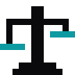
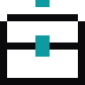

<p align="center">
  
</p>

<p align="center">
  <b>Your AI agent cuts a trailer from your real game, tunes its numbers, designs its economy, and plays it like real players in a phone browser.</b><br>
  Skills and a small CLI for Claude Code, Codex, Cursor, Gemini CLI, Copilot and OpenCode.
</p>

<p align="center">
  <a href="#install"></a>
  <a href="knowledge/INDEX.md"></a>
  <a href="LICENSE"></a>
</p>

<p align="center"><b>Website:</b> <a href="https://wiserax.dev/wisecraft/">wiserax.dev/wisecraft</a></p>

## What you can do

<!-- GitHub shrinks images in auto-width tables: the fixed widths keep the pixel icons at size. -->
<table>
  <tr>
    <td width="96" align="center"><a href="#game-trailer"><picture><source media="(prefers-color-scheme: dark)" srcset="docs/media/icons/trailer-dark.svg"></picture></a></td>
    <td>
      <h3><a href="#game-trailer">Game trailer</a>: a trailer cut from your real game</h3>
      <b>Frame-exact captures, smooth slow motion, cuts on the beat, titles, music mixed to loudness, vertical and 16:9.</b><br>
      Ask your agent: <i>"Make a 30-second vertical trailer of my game with a slow-motion boss finale, and a 16:9 version."</i>
    </td>
  </tr>
</table>

<table>
  <tr>
    <td width="33%" valign="top">
      <a href="#balance--economy"><picture><source media="(prefers-color-scheme: dark)" srcset="docs/media/icons/balance-dark.svg"></picture></a><br>
      <b><a href="#balance--economy">Balance &amp; economy</a></b><br>
      Waves, HP, damage and prices tuned with player-model bots, measured before and after.<br>
      Ask your agent: <i>"Stage 1 is too easy. Rebalance it and prove it with bots."</i>
    </td>
    <td width="33%" valign="top">
      <a href="#meta--monetization"><picture><source media="(prefers-color-scheme: dark)" srcset="docs/media/icons/meta-dark.svg"></picture></a><br>
      <b><a href="#meta--monetization">Meta &amp; monetization</a></b><br>
      Loot boxes with pity math, currencies that don't inflate, a shop, offers and a season pass, played fair.<br>
      Ask your agent: <i>"Design a chest with pity and disclosed odds."</i>
    </td>
    <td width="33%" valign="top">
      <a href="#virtual-qa-testers"><picture><source media="(prefers-color-scheme: dark)" srcset="docs/media/icons/qa-dark.svg"></picture></a><br>
      <b><a href="#virtual-qa-testers">Virtual QA testers</a></b><br>
      Bots that play like tappers, idlers and spenders in muted phone-sized Chromium and WebKit.<br>
      Ask your agent: <i>"Test it like real players on an iPhone-sized screen."</i>
    </td>
  </tr>
</table>

## Install

Pick your agent. Each gets the same skills (Agent Skills format) and the `wise` CLI.

| Agent | Install |
|---|---|
| **Claude Code** | `/plugin marketplace add Wiserax/wisecraft`<br>`/plugin install wisecraft@wisecraft` |
| **Codex** | `codex plugin marketplace add Wiserax/wisecraft`<br>`codex plugin add wisecraft@wisecraft` |
| **Gemini CLI** | `gemini extensions install https://github.com/Wiserax/wisecraft` |
| **VS Code / Copilot** | Enable `chat.plugins.enabled`, run **Chat: Install Plugin From Source**, and enter this repo's URL |
| **Cursor** | Clone it (Cursor reads `AGENTS.md` and `.agents/skills`) |
| **OpenCode** | Clone and run `opencode` inside it (`opencode.json` points it at `skills/`) |
| **Skills only**<br>(any agent) | `npx skills add https://github.com/Wiserax/wisecraft` |
| **Anything else** | `git clone https://github.com/Wiserax/wisecraft` and start your agent inside it |

**The `wise` CLI.** Plugin installs and clones put it on PATH. Anywhere else:
```bash
uv tool install git+https://github.com/Wiserax/wisecraft     # or: pip install git+https://github.com/Wiserax/wisecraft
```
For trailers you need ffmpeg. For the virtual testers, install Playwright in your game's folder:
```bash
npm i -D playwright && npx playwright install chromium webkit
```
You also need Python 3.10+ and Node 18+. `uv` is recommended.

## Game trailer
**Skill:** [`game-trailer`](skills/game-trailer). The agent makes the video from the running game, not from
mockups, and checks every frame and every decibel by measurement.

What you get:
- **A shot list and a capture plan:** a hook in the first 3 s, the core loop by 8 s, one idea per shot, a
  hero finale and an end card held to the last frame.
- **Frame-exact captures:** a paused clock and one simulation step per captured frame, so slow motion is
  smooth (a 0.25x shot is captured at 240 fps for a 60 fps cut) and the picture is full resolution.
- **An edit list (EDL)** cut on the music's beat and snapped to whole frames, compiled by `wise video compile`.
- **Titles inside platform safe zones,** the game's own sound effects over licensed music, the music ducked on
  impacts, and the mix levelled to -14 LUFS with a -1 dBTP ceiling by `wise music-enhance`.
- **Exports:** a 1080x1920 vertical master and a reframed (not cropped) 1920x1080, checked by
  `wise video check` (length, fps, cuts, loudness, the first frame, and frames that repeat), plus a
  ten-line scorecard and a NOTES file of what was staged.

## Balance & economy
**Skill:** [`game-balance`](skills/game-balance). The numbers inside a run, tuned against bots and proven in a
real browser.

What you get:
- **Real analytics read first:** where players fall, retries per stage, what they buy first.
- **Player-model bots** (passive, casual, heavy tapper, attentive) on fixed seeds, with the same table before
  and after every change: cleared, lost, walls left, first hit, fall time.
- **A difficulty index** that turns "make it 60-70% as hard as the old version" into a number per bot.
- **Curves:** rising-sine stages, a sawtooth chapter, pressure vs DPS per wave, geometric price ladders, boss
  tiers and tap multipliers. `scripts/curves.py` prints a stage's table before any bot runs.
- **The first session proven in a phone browser,** because simulations lie about first sessions.

## Meta & monetization
**Skill:** [`game-meta`](skills/game-meta). Why players come back and what they pay for, computed instead of
guessed.

What you get:
- **Drop tables and gacha:** rarity tiers, value per pull, soft and hard pity, the 50/50 featured guarantee,
  duplicates and shards. `scripts/drop_table.py` gives mean and 99th-percentile pulls and checks the
  disclosed odds against the weights.
- **Currencies:** soft, premium and event currencies with a faucet and sink ledger per day;
  `scripts/economy_ledger.py` flags inflation, debt and dead sinks.
- **Shop, starter pack, offers, season pass, subscriptions and rewarded ads,** sized from play time.
- **Progression and retention:** the difficulty curve across sessions, rescue gifts only after a fall,
  rewards paid the instant a run ends, daily and weekly loops.
- **Guardrails:** odds disclosure by market, no dark patterns, care with minors.

## Virtual QA testers
**Skill:** [`game-qa`](skills/game-qa). Persona bots play the real build in muted, phone-sized Chromium and
WebKit, through the real UI.

```text
$ wise qa http://127.0.0.1:5891/shop.html --persona spender --seconds 6 --ready "window.__game"
PASS  chromium 390x844  http://127.0.0.1:5891/shop.html
  ...
  persona:      spender
  bought:       3
    - Upgrade  x2
    - Open chest  x1
  frame time:   366 frames, 60 fps, p50 16.7 ms, p95 16.7 ms, p99 16.8 ms, 0 over 33 ms, worst 16.8 ms
  errors:       none
  overflow:     none
  ...
  board:        qa-out/chromium-390x844-spender/board.png
```
What you get:
- **Personas:** a casual player, a heavy tapper, an idler, and a spender that buys with in-game currency and
  never touches a real-money button.
- **The gate:** console and page errors, layout that overflows a 320 px phone, failed requests, and frame
  time (p50/p95/p99, frames over 33 ms, an optional p95 limit).
- **Evidence:** a screenshot at every step and a board of the whole run.
- **Journeys and profiles:** returning players with real old saves, day rollover, rotate, hidden tab, double
  taps, reload mid-reward, a boot that never hangs, capacity and late-game frame tests.

## The commands
Every command has `--help` with examples. Nothing ever plays sound.

| | Command | What it does |
|---|---|---|
| <picture><source media="(prefers-color-scheme: dark)" srcset="docs/media/icons/video-dark.svg"></picture> | `wise video` | `compile` an EDL into a finished trailer (beat grid, titles, speed, sound effects, music); `check` a finished file or a folder of takes; `contact` sheets, `probe`, `beats`, `first-frame` |
| <picture><source media="(prefers-color-scheme: dark)" srcset="docs/media/icons/qa-dark.svg"></picture> | `wise qa` | Virtual testers: a muted phone-sized Chromium or WebKit plays like a player (`--persona casual\|tapper\|idler\|spender`); errors, overflow and frame time fail the run; screenshots and a board |
| <picture><source media="(prefers-color-scheme: dark)" srcset="docs/media/icons/music-enhance-dark.svg"></picture> | `wise music-enhance` | Measure and fix loudness (EBU R128) of a trailer, music, game sounds or voice: `--for trailer` levels to -14 LUFS under -1 dBTP and copies the picture untouched; `--check` only measures |
| <picture><source media="(prefers-color-scheme: dark)" srcset="docs/media/icons/board-dark.svg"></picture> | `wise board` | HTML mockups to phone-sized PNG screens and one review board (for the design-boards extra) |
| | `wise studio` | A live side panel (`--open` puts it in Orca's browser pane): every agent at work with its current action, time and ≈$, and a feed of new screenshots, videos and 3D models to 👍 / 👎, saved to `reviews.jsonl` for the agents |

## Also included
Smaller skills that ship alongside the four main ones:

| Skill | One line |
|---|---|
| [`game-ui-kit`](skills/game-ui-kit) | A clean hub with one golden call to action, a one-row battle bar, a wordless first session, 320 px phones |
| [`game-feel-audio`](skills/game-feel-audio) | Bosses you feel (entrance, slam, death), a VFX quality bar, and a mix that is measured, never played aloud |
| [`game-vfx`](skills/game-vfx) | Effects from references, never from scratch: Pinterest refs shown to you first, then rebuilt in Three.js in a hand-drawn 2.5D style, with a ref-vs-ours board |
| [`feature-design`](skills/feature-design) | An idea to a tested design: the core cycle, a wordless interface map, a persona player panel and a publisher check, iterated until green-light, scoped to the deadline |
| [`design-boards`](skills/design-boards) | HTML mockups to phone-sized boards with `wise board`, and boards of real screenshots |
| [`agent-orchestration`](skills/agent-orchestration) | A lead and worker agents with file ownership, a mailbox and milestone notes |
| [`progress`](skills/progress) | `/progress`: every running agent on one board, grouped by account, with a stage bar, time, tokens and API-equivalent $ |
| [`studio`](skills/studio) | `wise studio`: the live panel beside the work, agents and a review feed of everything they render |

Field notes from real work live in [`knowledge/`](knowledge/INDEX.md), filed by the pillar they serve.

## Rules it follows
- **Real data first.** It decides from real player analytics, real saves, real devices and the live build;
  simulations, bots and fixtures only fill gaps where real data does not exist yet.
- **Spending money needs a yes.** No real purchases, no paid services, paid generation or paid agent runs
  unless you say so. Spender bots use in-game currency and debug grants.
- **It never plays audio through your speakers.** Browsers run muted; mixes are measured.
- **It asks before** pushing, deploying or publishing anything, videos and pull requests included.

The full list is in [`AGENTS.md`](AGENTS.md).

## Credits
- Created by Alex Wiserax. Architecture, README design and parts of the tooling adapted from
  [Universal Modder](https://github.com/rehan-remade/universal-modder) by Rehan, MIT. The ported files are listed
  in [`NOTICE`](NOTICE).
- Built from real agent sessions on a shipped mobile web game.
- Standing on the shoulders of three.js, Vite, Playwright and ffmpeg.

Brand type: Geist and JetBrains Mono. Video titles: Space Grotesk and JetBrains Mono. All under the SIL OFL.

## License

[MIT](LICENSE)
