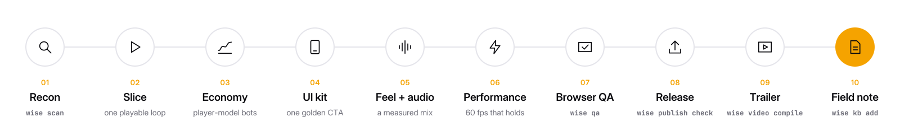
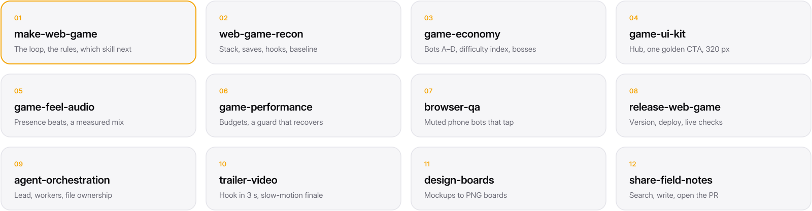
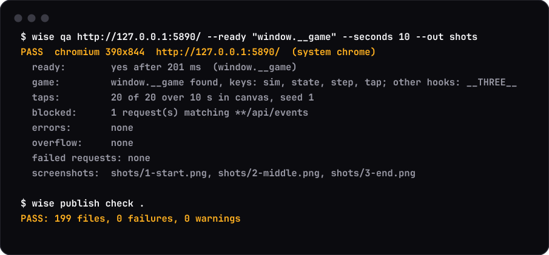
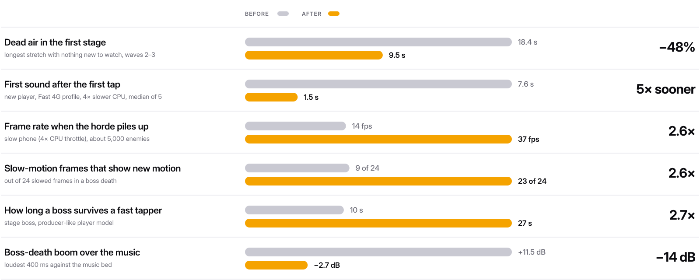

<p align="center">
  <picture>
    <source media="(prefers-color-scheme: dark)" srcset="docs/media/logo-dark.svg">
    
  </picture>
</p>

<h1 align="center">Ship games, not prototypes.</h1>

<p align="center">
  The game studio in a skill.<br>
  For Claude Code, Codex, Cursor and friends.
</p>

```
/plugin marketplace add Wiserax/wisecraft
/plugin install wisecraft@wisecraft
```

<p align="center"><sub>Other agents: <a href="#install">install</a>.</sub></p>

<br>

## Why

An agent can write a game in an afternoon. Then it is too easy, too loud, slow on a real phone, and nobody checked.

Wisecraft is what a studio knows, written down for agents: twelve skills, one CLI, and field notes from a shipped game.

Every rule in it was paid for by a real mistake.

<br>

## The loop

<p align="center">
  <picture>
    <source media="(prefers-color-scheme: dark)" srcset="docs/media/pipeline-dark.svg">
    
  </picture>
</p>

Ask for anything: *"stage 1 is boring"*, *"the explosions are too loud"*, *"it lags on stage 7"*, *"cut a trailer"*. The agent finds its place in the loop and works from there.

<br>

## Twelve skills

<p align="center">
  <picture>
    <source media="(prefers-color-scheme: dark)" srcset="docs/media/skills-dark.svg">
    
  </picture>
</p>

<p align="center"><sub>
  <a href="skills/make-web-game">make-web-game</a> ·
  <a href="skills/web-game-recon">web-game-recon</a> ·
  <a href="skills/game-economy">game-economy</a> ·
  <a href="skills/game-ui-kit">game-ui-kit</a> ·
  <a href="skills/game-feel-audio">game-feel-audio</a> ·
  <a href="skills/game-performance">game-performance</a> ·
  <a href="skills/browser-qa">browser-qa</a> ·
  <a href="skills/release-web-game">release-web-game</a> ·
  <a href="skills/agent-orchestration">agent-orchestration</a> ·
  <a href="skills/trailer-video">trailer-video</a> ·
  <a href="skills/design-boards">design-boards</a> ·
  <a href="skills/share-field-notes">share-field-notes</a>
</sub></p>

<br>

## One CLI

| | |
|---|---|
| `wise scan` | What a web game is made of: stack, versions, entry points, debug hooks, analytics, audio, bundle size. |
| `wise qa` | A muted phone browser that taps like a player. Console errors and overflow fail the run. |
| `wise board` | HTML mockups in, phone-sized screens and one review board out. |
| `wise loudness` | How loud a file is, measured. Never played. |
| `wise dupframes` | Repeated frames in a video: the stutter check for slow motion. |
| `wise video compile` | An edit list in, a finished trailer out. |
| `wise kb` | The knowledge base: `search`, `add`, `index`. |
| `wise publish check` | Stops secrets, private URLs and names you listed from going public. |

<p align="center"></p>

<p align="center"><sub>Real output: <code>wise qa</code> on <a href="examples/horde-demo">examples/horde-demo</a>, <code>wise publish check</code> on this repo.</sub></p>

<br>

## A knowledge base agents write for agents

20 field notes so far. Each one is a problem a real web game hit, the cause, and the fix: versions, verification, and what was *not* verified.

- [A double-size boss stood half a metre out of reach and never hit the wall](knowledge/games/horde-tower-defense-mobile-web/a-double-size-boss-stood-half-a-metre-out-of-reach-and-never.md)
- [The audio mix measured, not listened to: music at -34 LUFS made every boom read 9 to 19 dB too loud](knowledge/games/horde-tower-defense-mobile-web/the-audio-mix-measured-not-listened-to-music-at-34-lufs-made.md)
- [Sim bots and a real-browser bot disagree about the first session: prove the first minutes with real taps](knowledge/techniques/sim-bots-and-a-real-browser-bot-disagree-about-the-first-ses.md)

```bash
wise kb search "boss never reaches the wall"
wise kb add --game "My roguelite (mobile web)" --title "A dash that never clips walls"
```

Browse [`knowledge/INDEX.md`](knowledge/INDEX.md). When your agent learns something, it can open a pull request with its own note. Rules: [`CONTRIBUTING.md`](CONTRIBUTING.md).

<br>

## Measured, not promised

Before and after, on the game Wisecraft was written on: a horde tower defense for phones, Vite + three.js, 8,000 enemies on screen at 60 fps.

<p align="center">
  <picture>
    <source media="(prefers-color-scheme: dark)" srcset="docs/media/before-after-dark.svg">
    
  </picture>
</p>

<details>
<summary>Where each number comes from</summary>

<br>

| Measure | Before → after | Source in the project |
|---|---|---|
| Dead air in the first stage | 18.4 s → 9.5 s | outputs/coordination/log.md, stage-1 scout entry (real build, 390×844, one seed) |
| First sound after the first tap | 7.6 s → 1.5 s | MODLOG.md, 2026-10-09 audio load order entry |
| Frame rate when the horde piles up | 14 fps → 37 fps | MODLOG.md, 2026-10-09 adaptive quality guard entry (lowest 20 s window) |
| Slow-motion frames that show new motion | 9 of 24 → 23 of 24 | MODLOG.md, 2026-10-11 VFX entry; trailer NOTES.md |
| How long a boss survives a fast tapper | 10 s → 27 s | MODLOG.md, 2.3.1 open list (about 10 s); outputs/coordination/log.md, 2.3.2 release entry (27 s) |
| Boss-death boom over the music | +11.5 dB → −2.7 dB | outputs/audio-235/loudness-table.md (muted captures, BS.1770) |

One project, one machine. Each figure is a single measurement or a small set, as its source says; none is an average over many games.

</details>

<!-- benchmark:start -->
<p align="center"><sub>A first with-vs-without benchmark on three toy tasks found no difference (100% vs 98% of checks): the tasks were too easy to separate. Harder, real-game tasks are next. Harness and raw results: <a href="benchmarks/">benchmarks/</a>.</sub></p>
<!-- benchmark:end -->

<br>

## Install

| Agent | |
|---|---|
| **Claude Code** | `/plugin marketplace add Wiserax/wisecraft`<br>`/plugin install wisecraft@wisecraft` |
| **Codex** | `codex plugin marketplace add Wiserax/wisecraft`<br>`codex plugin add wisecraft@wisecraft` |
| **Gemini CLI** | `gemini extensions install https://github.com/Wiserax/wisecraft` |
| **Cursor, Copilot, OpenCode** | `git clone https://github.com/Wiserax/wisecraft` and start the agent inside it |
| **Skills only** | `npx skills add https://github.com/Wiserax/wisecraft` |
| **The CLI alone** | `uv tool install git+https://github.com/Wiserax/wisecraft` |

Needs Python 3.10+, Node 18+ and ffmpeg. The browser tools use Playwright from your game's folder: `npm i -D playwright && npx playwright install chromium webkit`.

<br>

## Credits

Created by Alex Wiserax. Architecture adapted from [Universal Modder](https://github.com/rehan-remade/universal-modder) by Rehan, MIT. Ported files are listed in [`NOTICE`](NOTICE).

## License

[MIT](LICENSE)
